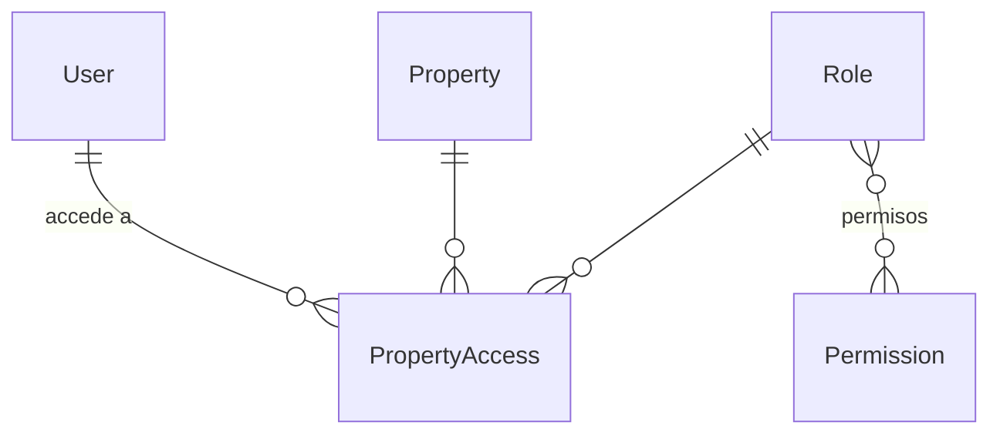

# App `accounts`

Ver [[Decisión - Permisos módulo por acción]].

- **User** (`AUTH_USER_MODEL`): usa el modelo de Django y le agrega teléfono, idioma, propiedad por defecto
  y `must_change_password`. Las contraseñas usan Argon2.
- **Permission**: "módulo.acción". Se sincroniza con `permissions.MODULES` en cada `migrate`.
- **Role**: código, nombre, descripción, permisos (M2M), `is_system`, `max_discount_percent` y
  `approval_limit`.
- **PropertyAccess**: une usuario, propiedad y rol. Es único por usuario y propiedad, y tiene `is_active`.

Métodos clave de `User`:
- `has_pms_perm(property, "modulo.accion")`
- `pms_permissions(property)`
- `role_for(property)`
- `accessible_properties()`
