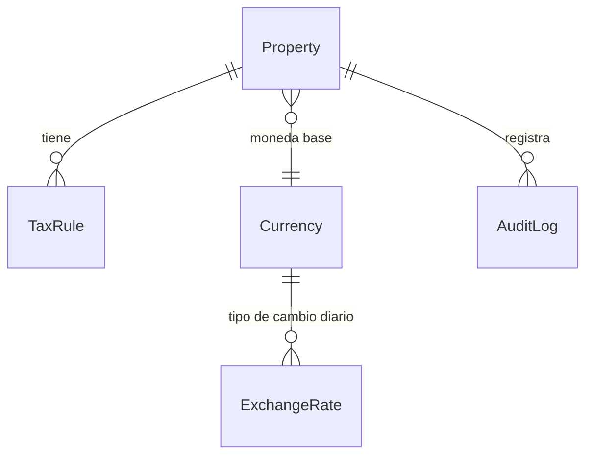

# App `core`

Núcleo compartido por todas las apps. Ver [[Decisión - Auditoría inmutable]].

## Modelos abstractos

| Modelo | Campos | Uso |
| --- | --- | --- |
| `TimeStampedModel` | created_at, updated_at, created_by, updated_by | Se llenan solos con el usuario de la petición |
| `SoftDeleteModel` | is_deleted, deleted_at, deleted_by | `delete()` marca; `objects` oculta eliminados; `all_objects` los incluye |
| `PropertyScopedModel` | property → Property | Aísla los datos por hotel |

## Modelos

- **Property**: código, nombre, razón social, RUC (validado: 11 dígitos), tipo, estrellas, dirección,
  ubigeo, horas de check-in y check-out, logo, color de marca. Usa borrado lógico.
- **Currency**: PEN y USD, creadas por la migración 0002.
- **ExchangeRate**: fecha, moneda, compra y venta (`Decimal(10,4)`). Hay uno por día y moneda, y la venta
  debe ser mayor o igual que la compra (restricción en la base). `ExchangeRate.for_date()` devuelve el
  último vigente.
- **TaxRule** (por propiedad): código, nombre, tasa `Decimal(5,2)`, a qué se aplica, si está incluido en
  el precio, si se exonera a no domiciliados.
- **AuditLog**: timestamp, usuario, propiedad, acción, objeto (tipo, id y texto), cambios en JSON, motivo,
  IP y navegador. Es **inmutable**: lo protegen el modelo y un trigger de PostgreSQL.
