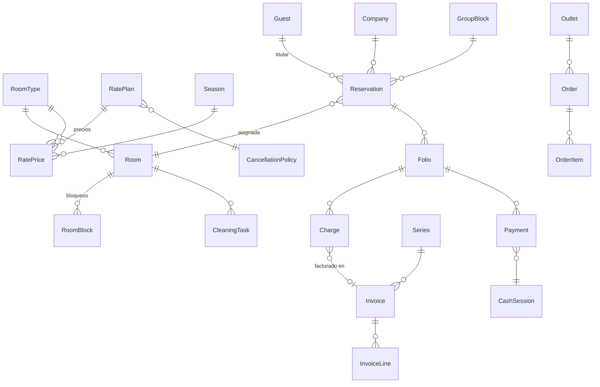

# Modelo de datos de la fase 1

| App | Modelos |
| --- | --- |
| `rooms` | RoomType (3 idiomas), Room (estado de limpieza, conectadas), RoomBlock, RoomInventoryItem |
| `rates` | CancellationPolicy, RatePlan (derivadas por %), Season, RatePrice (suplementos), DateRestriction, Promotion |
| `guests` | Guest (documento y salud cifrados + índice ciego), Company (empresa, agencia, operador, OTA) |
| `reservations` | Reservation (restricción de exclusión), GroupBlock + GroupAllotment, WaitlistEntry |
| `folio` | Concept, Folio, Charge (IGV desglosado), Payment (PEN/USD), CashRegister, CashSession, PettyCashExpense |
| `billing` | Series, Invoice, InvoiceLine, SunatSubmission, SimulationSettings, FakeTaxpayer, FakePerson |
| `frontdesk` | RegistrationCard (firma), RoomMove, LuggageTicket, ShiftLog, WakeUpCall, NightAudit |
| `housekeeping` | CleaningTask (checklist, inspección), LostItem, LinenType, LinenMovement, MinibarItem |
| `pos` | Outlet, Table, MenuCategory, MenuItem (3 idiomas), Order, OrderItem, BreakfastLog |
| `comms` | MessageTemplate (es/en/pt), AutomationSetting, Message, Notification |
| `core` | + Sequence (correlativos con bloqueo), Property.business_date, redondeo, cargos early/late |
