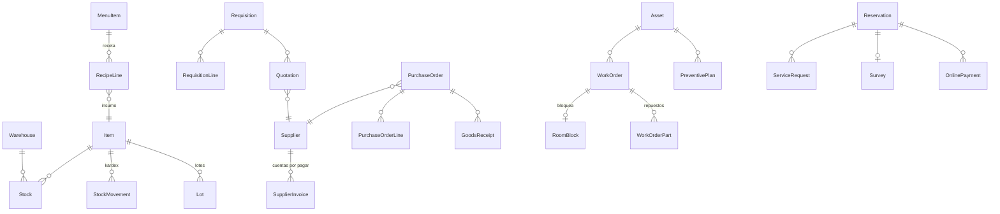

# Modelo de datos de la fase 2

| App | Modelos |
| --- | --- |
| `inventory` | Warehouse, ItemCategory, Item, Stock (costo promedio por almacén), Lot, StockMovement (kardex), StockCount, StockCountLine, Waste, RecipeLine |
| `purchasing` | Supplier, Requisition, RequisitionLine, Quotation, QuotationLine, PurchaseOrder, PurchaseOrderLine, GoodsReceipt, SupplierInvoice |
| `maintenance` | Asset (activos fijos y equipos), WorkOrder, WorkOrderPart, PreventivePlan |
| `payments` | OnlinePayment (solo token, marca y últimos 4 dígitos) |
| `portal` | ServiceRequest, Survey, Complaint (libro de reclamaciones) |
| Cambios | Reservation.precheckin_at, Outlet.warehouse, MinibarItem.inventory_item |
