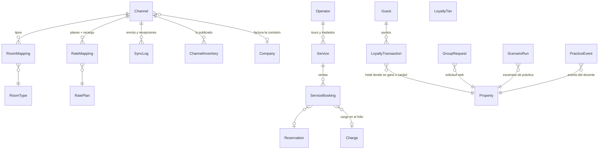

# Modelo de datos de la fase 3

## Apps y tablas
- **`pms_channels`** (app `apps.channels`; la etiqueta evita chocar con el paquete `channels` de Django):
  `Channel`, `RoomMapping`, `RateMapping`, `SyncLog`, `ChannelInventory`.
- **`tours`**: `Operator`, `Service` (nombres en es/en/pt, precio y costo por persona), `ServiceBooking`
  (guarda precio y costo del momento de la venta).
- **`booking_engine`**: `GroupRequest`. Las reservas web son `Reservation` con `channel="web"`.
- **`guests`**: `LoyaltyTier` y `LoyaltyTransaction`. Son de la cadena, como `Guest` (RF-MUL-03), por eso no
  heredan `PropertyScopedModel`; cada movimiento guarda en qué hotel ocurrió.
- **`folio`**: nuevo medio de pago `points` (canje de puntos).
- **`classroom`**: `ScenarioRun` (datos del escenario en JSON) y `PracticeEvent`.

Ver también [[fase-1]], [[fase-2]], [[Decisión - Channel manager y motor web]] y [[Decisión - Modo aula]].
