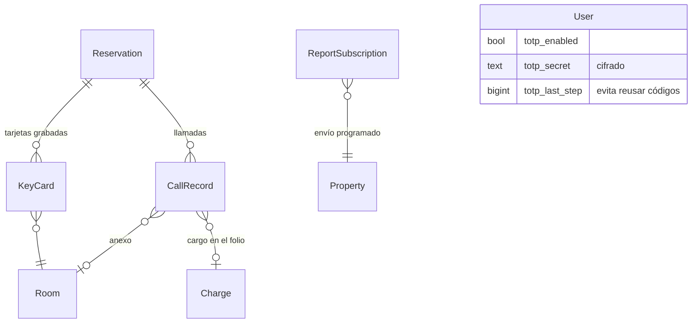

# Modelo de datos de la fase 4

## Cambios
- **`accounts.User`**: `totp_secret` (cifrado con Fernet), `totp_enabled`, `totp_last_step` (RF-SEG-03).
- **`integrations`** (app nueva):
  - `KeyCard`: tarjeta grabada por el adaptador de cerradura, con su vigencia;
  - `CallRecord`: registro de la central, con `external_id` único por hotel para no cobrar dos veces.
- **`reports.ReportSubscription`**: reporte, destinatarios, frecuencia, formato y último envío (RF-REP-06).
- **`folio.Charge.Source`**: nuevo origen `phone`.
- **Índices** (RNF-REN-01/02):
  - `res_prop_departure` (propiedad, salida) en reservas;
  - en PostgreSQL, índices de trigramas `pg_trgm` en nombres de huésped y código de reserva.

## Facturación completa (2026-10-15)
- `Invoice`:
  - nuevos campos `xml`, `cdr_xml`, `observations` y `prepaid_amount`;
  - `applied_to`: el anticipo apunta al comprobante final;
  - estado `voiding` (baja en proceso).
- `SunatRegistry`: lo que la SUNAT simulada recibió (RUC, tipo, serie, número, total, hash, estado). Es único
  por comprobante.
- `SunatTicket`: tickets RC/RA/GRE con estado 98/0/99, XML enviado y CDR.
- `RemissionGuide` + `RemissionLine`: guía de remisión remitente (serie T001).
- `SimulationSettings`: eliminado. La SUNAT simulada no se configura.

Ver también [[fase-3]] y [[Decisión - Rendimiento con historial grande]].
